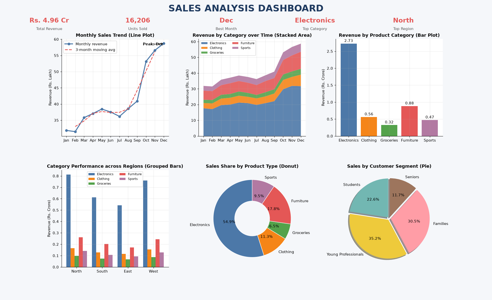
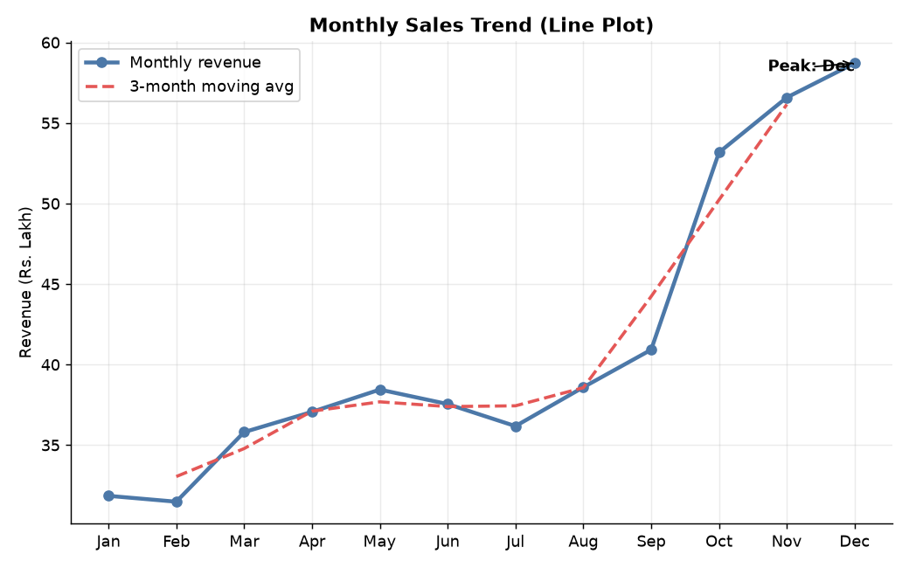
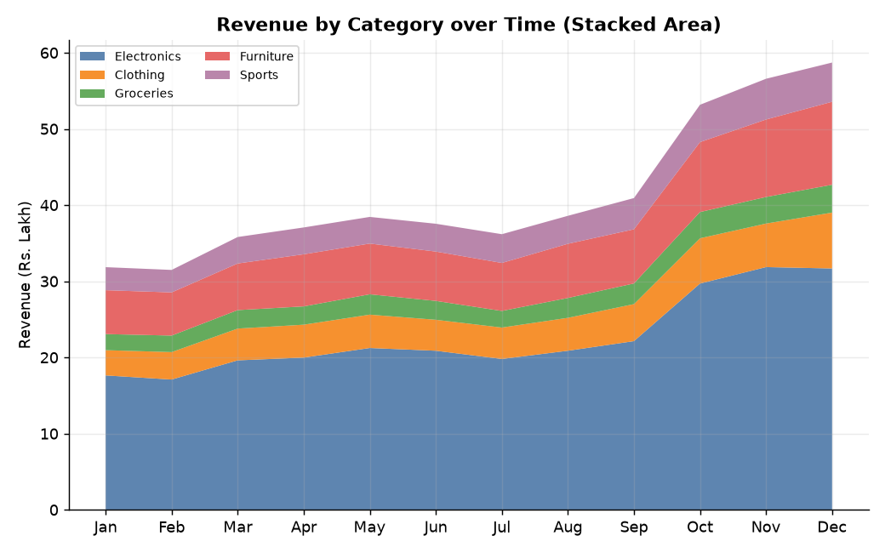
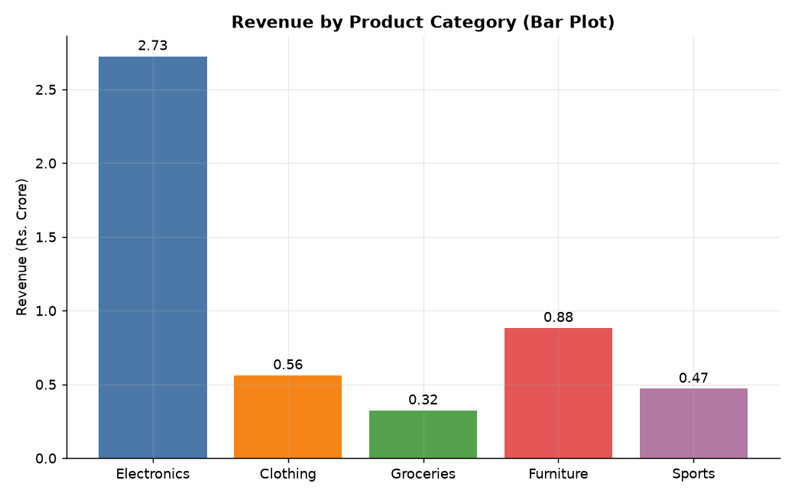
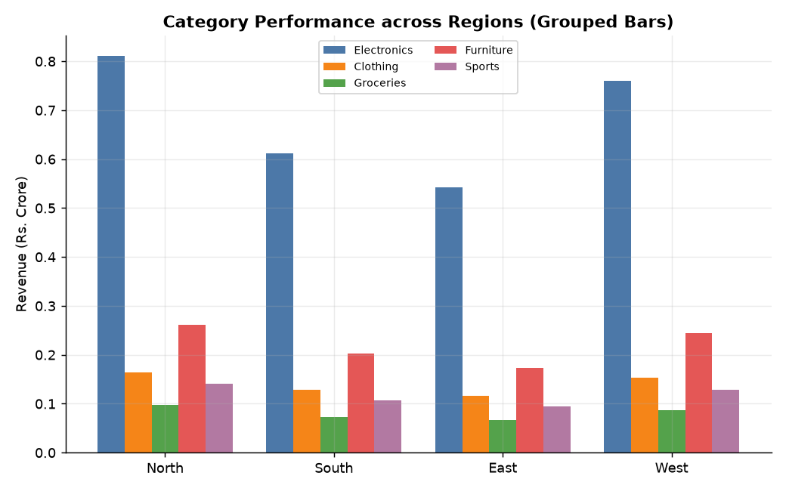
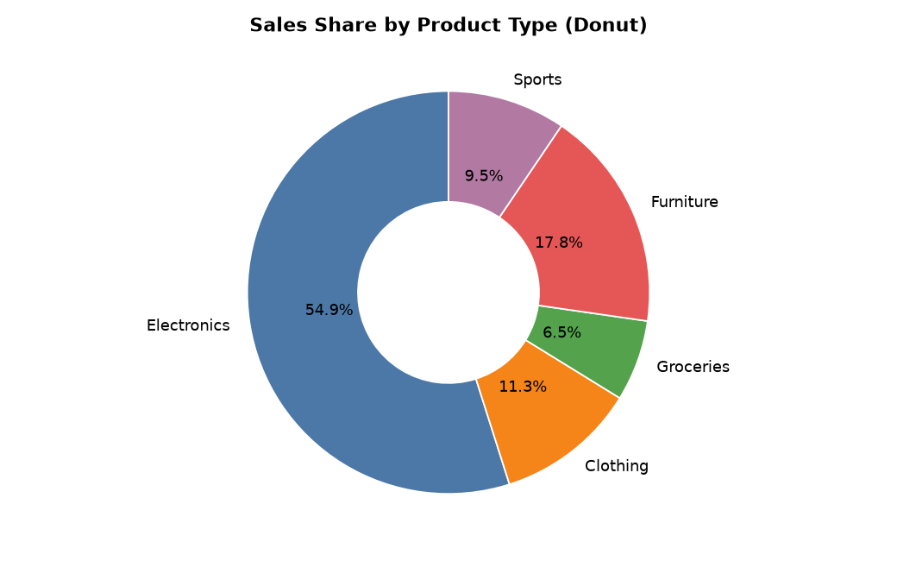
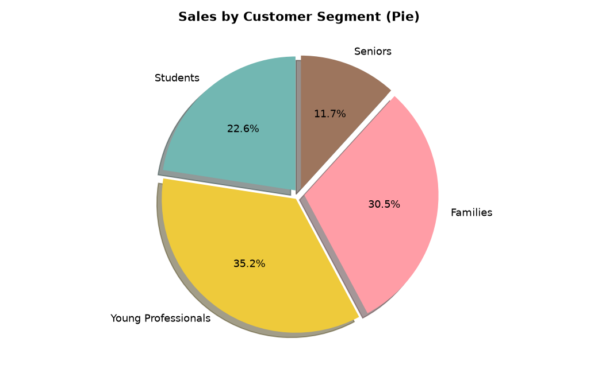
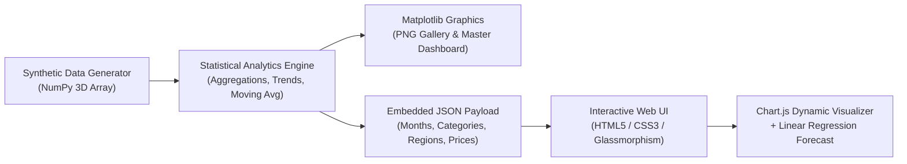

# 📊 Sales Analysis & Forecasting Dashboard

<p align="center">
  
  
  
  
  
  
</p>

<p align="center">
  <strong>An end-to-end Sales Analytics, Data Modeling, and Interactive Business Intelligence Dashboard.</strong><br>
  Built with high-performance <strong>NumPy</strong> statistical processing, publication-grade <strong>Matplotlib</strong> visualizations, and an ultra-responsive <strong>Glassmorphic Web UI</strong> featuring real-time linear regression forecasting.
</p>

<p align="center">
  <a href="#-executive-master-dashboard">Executive Dashboard</a> •
  <a href="#-key-features">Key Features</a> •
  <a href="#-visual-analytics-gallery">Visual Gallery</a> •
  <a href="#-tech-stack--architecture">Tech Stack</a> •
  <a href="#-installation--usage">Getting Started</a> •
  <a href="#-project-structure">Project Structure</a> •
  <a href="#-academic-credits">Academic Details</a>
</p>

---

## 🎯 Project Overview

This mini-project demonstrates the synergy between **scientific computing in Python** and **modern front-end business intelligence**. It models synthetic multi-dimensional annual retail performance across categories, regions, customer demographics, and seasonal variations.

- **Data Simulation & Aggregation**: Uses multi-dimensional NumPy array broadcasting with realistic festive Q4 surges and normal distribution noise.
- **Statistical Analytics**: Moving averages, multi-axis aggregation, variance modeling, and least-squares linear trend forecasting.
- **Static Publication Graphics**: High-DPI Matplotlib exports for automated business reports.
- **Dynamic Interactive Dashboard**: Client-side filtering, animated KPIs, dark/light theme switching, and instant CSV exports.

---

## 🖥️ Executive Master Dashboard

The all-in-one consolidated analytics command center exported via Matplotlib:

<p align="center">
  
</p>

---

## ✨ Key Features

### 1. ⚡ High-Performance NumPy Data Engine
- **3D Array Tensor Operations**: Processes structured matrices shaped `(12 Months × 5 Categories × 4 Regions)` with vectorized NumPy operations.
- **Demographic Allocation**: Allocates volume among 4 customer tiers (*Students, Young Professionals, Families, Seniors*) based on statistical propensity matrices.
- **Rolling Moving Average**: 3-month smoothing calculation using `np.convolve` to track momentum and smooth seasonal volatility.

### 2. 📈 Publication-Ready Matplotlib Visualizations
- Standalone high-resolution plots generated directly to PNG format using Matplotlib's non-interactive `Agg` backend.
- Custom corporate palettes, callout annotations for peak sales months, and exploded 3D shadow pie charts.
- Master multi-grid executive dashboard generated with `GridSpec` containing 6 charts and KPI headline summaries.

### 3. 🌐 Glassmorphic Interactive Web Dashboard (`index.html`)
- **Fluid Modern UI**: Animated backdrop filters, frosted-glass cards, and gradient headers.
- **Dark / Light Mode**: One-click theme switcher dynamically synchronizing typography and chart canvas color schemes.
- **Interactive Multi-Filter Bar**:
  - Filter by Region (*North, South, East, West, or All*)
  - Month Range Slider (*From Month → To Month*)
  - Metric Switcher (*Revenue in ₹ Lakh/Cr vs. Quantity in Units*)
  - Interactive Category Chips (Click-to-toggle individual categories)
- **3-Month Linear Regression Forecast**: Computes real-time trendlines based on ordinary least-squares regression directly in Chart.js.
- **Dynamic Leaderboard & Insights**: Live Top-5 Region-Category rank table and automated plain-text business performance bullet points.
- **One-Click CSV Export**: Downloads current filtered dataset view as a `.csv` file.

---

## 🖼️ Visual Analytics Gallery

Here are the individual analytical charts generated by the Python data engine:

| 1. Monthly Sales Trend (Line + 3M Moving Avg) | 2. Category Revenue Over Time (Stacked Area) |
| :---: | :---: |
|  |  |
| *Identifies peak sales velocity (Festive Q4 surge) with a 3-month smoothed moving average.* | *Highlights multi-category market expansion and category sales evolution over 12 months.* |

| 3. Product Category Revenue (Bar Plot) | 4. Regional Performance (Grouped Bars) |
| :---: | :---: |
|  |  |
| *Direct comparison of top grossing categories (Electronics, Furniture, Sports, Groceries, Clothing).* | *Regional cross-tabulation comparing performance across North, South, East, and West.* |

| 5. Sales Share by Product Type (Donut) | 6. Sales by Customer Segment (Pie Chart) |
| :---: | :---: |
|  |  |
| *Percentage revenue distribution across key inventory classifications.* | *Demographic breakdown showing revenue generated across diverse buyer personas.* |

---

## 🛠️ Tech Stack & Architecture



| Component | Technology | Description |
| :--- | :--- | :--- |
| **Data Engine** | Python 3, NumPy | Array broadcasting, randomized noise distributions, matrix calculations |
| **Static Visualizer** | Matplotlib (`Agg`) | PNG chart rendering, custom typography, annotations, GridSpec dashboards |
| **Front-End View** | HTML5, CSS3 | Glassmorphism styling, CSS Keyframe animations, Dark/Light theme engine |
| **Interactive Charts**| Chart.js (v4.4.1) | Dynamic line, stacked area, bar, doughnut, and pie charts |
| **Deployment / Host** | XAMPP / Apache / Local Browser | Runs seamlessly out of `htdocs` or directly standalone in any browser |

---

## 📂 Project Structure

```text
Sales-Dashboard-Mini-project-/
│
├── sales_dashboard.py         # Main Python engine (Data generation, analytics, charts & HTML)
├── README.md                  # Detailed documentation & visual showcase
│
└── sales_dashboard/           # Output directory (Web & image assets)
    ├── index.html             # Fully standalone interactive web dashboard
    ├── dashboard.png          # Master executive dashboard overview (18x11)
    ├── 1_line_trend.png       # Monthly sales trend with peak & moving average
    ├── 2_area_chart.png       # Stacked area chart of category revenues
    ├── 3_bar_category.png     # Category revenue comparative bar chart
    ├── 4_bar_region.png       # Grouped bar chart comparing categories per region
    ├── 5_pie_category.png     # Donut chart of revenue share by product type
    └── 6_pie_segment.png      # 3D exploded pie chart by customer segment
```

---

## 🚀 Installation & Usage

### Prerequisites
Make sure you have Python 3.8+ installed on your system.

### 1. Clone the Repository
```bash
git clone https://github.com/adarshraj29/Sales-Dashboard-Mini-project-.git
cd Sales-Dashboard-Mini-project-
```

### 2. Install Required Python Libraries
```bash
pip install numpy matplotlib
```

### 3. Generate Charts & Web Dashboard
Run the Python script to recalculate data and export all charts and the interactive dashboard:
```bash
python sales_dashboard.py sales_dashboard
```
> This will print a formatted summary report in your terminal and update all `.png` charts and `index.html` inside the `sales_dashboard/` directory.

### 4. Launch the Dashboard

#### Option A: Direct Browser Preview
Double click on `sales_dashboard/index.html` to open it directly in Google Chrome, Microsoft Edge, or Firefox.

#### Option B: Via Local XAMPP Server
1. Move or clone the project into your XAMPP web root directory:
   ```text
   C:\xampp\htdocs\sales_dashboard\
   ```
2. Start the **Apache** server in the XAMPP Control Panel.
3. Open your browser and navigate to:
   ```text
   http://localhost/sales_dashboard/
   ```

---

## 📊 Analytics Summary & Insights

When running the project, the NumPy computation pipeline automatically derives key executive statistics:

- **Revenue Momentum**: Rapid acceleration during Q4 (Festive October–December season).
- **Core Category Driver**: **Electronics** commands the highest gross revenue share.
- **Top Geographic Sector**: **North** leads total unit volume and regional revenue.
- **Key Demographic Persona**: **Young Professionals & Families** generate the highest customer lifetime value across high-ticket segments.

---

## 👨‍🎓 Academic Credits & Details

- **Author**: **Adarsh Raj**
- **UID**: `26MCA20214`
- **Course / Program**: Master of Computer Applications (MCA)
- **Subject**: Python Programming
- **Faculty Guide / Submitted to**: **Randeep Singh Dhillon**

---

<p align="center">
  ⭐ If you found this project helpful, feel free to give it a star on <a href="https://github.com/adarshraj29/Sales-Dashboard-Mini-project-">GitHub</a>!
</p>
